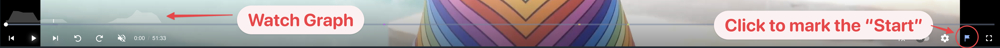

# Enhanced Stash Player

A [Stash](https://github.com/stashapp/stash) plugin that adds two things to the scene player:

- **Starts At:** set a start time for any scene, and playback jumps past the intro automatically. A
  **Skip intro** button handles the cases where it doesn't jump.
- **Watch trends:** a faint graph above the seek bar shows which parts of a scene get played the
  most, like YouTube's "most replayed".



**No Python, no backend, no dependencies.** It's plain JavaScript and CSS that runs in your browser.
There's nothing to install on the server, no AI model and nothing to download. Its data is stored in
Stash's own scene custom fields, so it's included in Stash's normal backups.

Requires **Stash v0.31.0 or newer**.

## Install

1. In Stash, go to **Settings → Plugins → Available Plugins → Add Source**, and add:
   ```
   https://undefinednull8080.github.io/enhanced-stash-player/stable/index.yml
   ```
2. Install **Enhanced Stash Player**.
3. **Refresh the browser tab.** Stash loads plugin scripts only when the page loads.

## Use

- **Set a start:** play to where the scene really starts, then click the **flag** in the player's
  control bar, just left of fullscreen. A toast confirms the time and offers Undo.
- **Clear it:** long-press or right-click the flag.
- **Auto-jump:** when you start playing, the player jumps to the start. It doesn't jump when:
  - you resume past the start
  - you seek yourself (a seek-bar click, a marker or a `?t=` link)
  - playback starts more than 15 s in

  The jump also applies when a queue moves to the next scene.
- **Skip intro:** appears before the start time whenever no jump happened.
- **Graph:** appears once a scene has been watched, shown with the player controls. A small tick
  marks the start time.

## Settings

**Settings → Plugins → Enhanced Stash Player**. Everything is on by default; refresh after
changing a setting.

| Setting | Effect |
| --- | --- |
| Don't jump to Starts At | Turns off the automatic jump; Skip intro still works |
| Lead-in (seconds) | Jumps this many seconds before the start (0–60, default 0) |
| Hide the watch graph | Hides the graph |
| Don't record watching | This browser stops counting and saving what it plays |

## Good to know

- **Where the data lives:** Starts At is the scene custom field `esp_start_at`. Each browser saves
  its counts in its own `esp_watch_<id>` field, and the graph adds them up. Delete these fields in
  the scene editor to reset a scene.
- **Several tabs and devices:** they can watch the same scene at once without losing counts.
- **When counts are saved:** on pause, at the end of the scene, when you leave it, and when the tab
  closes or goes to the background. Each save updates the scene's "updated" time and runs other
  plugins' scene-update hooks. To turn saving off, use Don't record watching.
- **The scene edit form:** saving it writes back every custom field as it was when the form opened.
  A Starts At set after you opened the form can be lost. This browser's watch counts restore
  themselves on its next save.
- **Private windows:** each one gets a new id, so it leaves its own `esp_watch_` field.
- **Replaced files:** if a scene's file is replaced with a different cut, the old counts no longer
  line up.

## Troubleshooting

No flag in the player? Refresh the page, then open the browser console (Cmd+Option+J or Ctrl+Shift+J).
When the plugin works, you'll see:

```
[ESP] Enhanced Stash Player 0.1.0 loaded (Stash v0.31.1)
[ESP] attached to scene 123
```

If something is wrong, an `[ESP]` warning there says why, for example a Stash version that's too
old. If there's no `[ESP]` line at all, the plugin's script didn't load. Check that the plugin is
enabled, and that Troubleshooting Mode is off.

## Development

See [docs/DEVELOPMENT.md](docs/DEVELOPMENT.md) for tests, the local Docker Stash, releasing and how
it works.

## License

The Unlicense (public domain). See [LICENSE](LICENSE).
